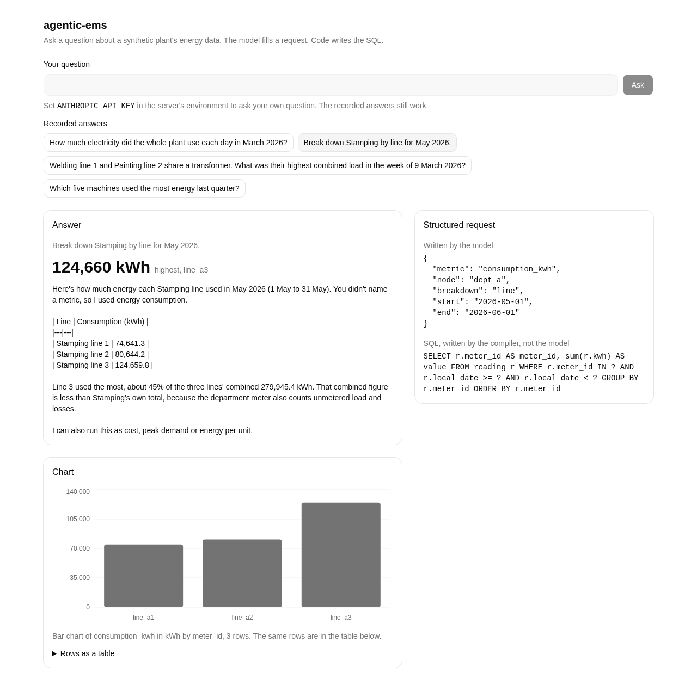

# agentic-ems

Written from scratch on synthetic data. No code, schema or data from any employer or customer.

## What I found

With the rules in its prompt, the model that writes SQL made no mistake. Without them it returned 12 wrong values in 275 runs, 4 of them double counts. The semantic layer cannot double count, but it covers only its four metrics, and outside them it returned ingredients, not answers.



The page above replays four recorded answers of the `semantic` arm. It runs from a clone, see [Run it](#run-it).

## What this is

Questions in plain language about one invented manufacturing plant's energy data, answered three ways by the same model, and scored against reference values. The plant has a meter tree: a site meter, four departments, ten lines, twenty-six machines. A parent meter already contains its children, so adding a department to one of its own lines counts the same kWh twice. That mistake is what this repository measures.

- **`semantic`**: the model never writes SQL. It fills a request (metric, meters, period, grain) and [`semantic.py`](src/agentic_ems/semantic.py) validates it and compiles the SQL. A request that sums a meter with its ancestor is refused before it runs.
- **`sql`**: the model writes DuckDB SQL after reading [`docs/schema.md`](docs/schema.md), which states the same rules in prose.
- **`sql_schema_only`**: the model writes SQL from the tables, columns, types and the meter tree alone. No rules.

## Results

<!-- results:start -->
**Runs whose returned rows held a wrong value** (known wrong plus other wrong, of the runs scored; the model's text is not scored): semantic 30 of 275 runs, sql 0 of 275 runs, sql_schema_only 12 of 275 runs.

5 of 5 repeats completed, 55 questions, model claude-opus-5-5, effort medium.

Spend: 13.60 EUR in the runs the table counts, 0.00 EUR in runs of an incomplete repeat and 0.01 EUR in attempts that were not scored, of a budget of 20.00 EUR.

| Arm | Group | Correct | Refusals | Known wrong | Other wrong | No answer | Cost EUR | EUR per correct | Earlier call correct |
|---|---|---|---|---|---|---|---|---|---|
| semantic | hierarchy | 104 of 105, 99% (83% to 100%) | 1 | 0 | 0 | 0 | 1.29 | 0.012 | 0 |
| semantic | control | 35 of 35, 100% (65% to 100%) | 0 | 0 | 0 | 0 | 0.39 | 0.011 | 0 |
| semantic | metric_definition | 30 of 30, 100% (61% to 100%) | 0 | 0 | 0 | 0 | 0.53 | 0.018 | 0 |
| semantic | out_of_scope | 0 of 65, 0% (0% to 23%) | 35 | 0 | 30 | 0 | 0.84 | none correct | 0 |
| semantic | unanswerable | 40 of 40 | 40 | 0 | 0 | 0 | 0.20 | 0.005 | 0 |
| sql | hierarchy | 105 of 105, 100% (85% to 100%) | 0 | 0 | 0 | 0 | 1.44 | 0.014 | 0 |
| sql | control | 35 of 35, 100% (65% to 100%) | 0 | 0 | 0 | 0 | 0.47 | 0.014 | 0 |
| sql | metric_definition | 30 of 30, 100% (61% to 100%) | 0 | 0 | 0 | 0 | 0.56 | 0.019 | 0 |
| sql | out_of_scope | 65 of 65, 100% (77% to 100%) | 0 | 0 | 0 | 0 | 0.87 | 0.013 | 0 |
| sql | unanswerable | 40 of 40 | 40 | 0 | 0 | 0 | 0.24 | 0.006 | 0 |
| sql_schema_only | hierarchy | 101 of 105, 96% (79% to 99%) | 0 | double_count 4 | 0 | 0 | 2.94 | 0.029 | 0 |
| sql_schema_only | control | 35 of 35, 100% (65% to 100%) | 0 | 0 | 0 | 0 | 0.69 | 0.020 | 0 |
| sql_schema_only | metric_definition | 27 of 30, 90% (50% to 99%) | 0 | 0 | 3 | 0 | 1.19 | 0.044 | 0 |
| sql_schema_only | out_of_scope | 65 of 65, 100% (77% to 100%) | 0 | 0 | 0 | 0 | 1.58 | 0.024 | 0 |
| sql_schema_only | unanswerable | 35 of 40 | 35 | 0 | 5 | 0 | 0.39 | 0.011 | 0 |

**Difference between arms**, semantic minus sql, in accuracy points, paired by question:

| Group | Difference | 95% interval |
|---|---|---|
| hierarchy | -1 | -3 to +0 |
| control | +0 | +0 to +0 |
| metric_definition | +0 | +0 to +0 |
| out_of_scope | -100 | -100 to -100 |

**Difference between arms**, semantic minus sql_schema_only, in accuracy points, paired by question:

| Group | Difference | 95% interval |
|---|---|---|
| hierarchy | +3 | +0 to +9 |
| control | +0 | +0 to +0 |
| metric_definition | +10 | +0 to +23 |
| out_of_scope | -100 | -100 to -100 |

**Difference between arms**, sql minus sql_schema_only, in accuracy points, paired by question:

| Group | Difference | 95% interval |
|---|---|---|
| hierarchy | +4 | +0 to +10 |
| control | +0 | +0 to +0 |
| metric_definition | +10 | +0 to +23 |
| out_of_scope | +0 | +0 to +0 |

**Example**, a double count from a recorded run (sql_schema_only arm, question H19, repeat 1):

> paint shop plus its line 2, total for January 2026

The SQL that ran:

```sql
SELECT sum(kwh) AS value FROM reading WHERE meter_id IN ('dept_c','line_c2') AND local_date >= DATE '2026-01-01' AND local_date < DATE '2026-02-01'
```

The value it returned:

```
value
213220.74000000002
```

The reference value:

```
value
157423.60100000023
```

[The transcript of this run](results/schema_only/runs/20261112T153515Z/H19-sql_schema_only-1.json)

Intervals: Wilson score 95% for accuracy with the number of questions as the sample size, because repeats of one question are not independent; a 95% bootstrap over questions (10,000 resamples, fixed seed) for differences.

Known wrong values are examples, not a complete list, so their counts are lower bounds.
<!-- results:end -->

Every figure above is generated from [`results/results.json`](results/results.json) and [`results/schema_only/results.json`](results/schema_only/results.json) by `uv run python -m agentic_ems.benchmark.report`. Each run has its transcript under `results/`, and a test fails if this block and the files disagree.

### What the runs show

The scorer reads the rows a run returns, because rows are what a chart or another program consumes. It does not read the model's text. Both are described here, and only the first is a score.

- **With the rules written down, the model that writes SQL made no mistake.** The `sql` arm returned no wrong value in 275 runs. The premise that text-to-SQL double counts on a meter tree did not hold for this model once the rules were in its prompt.
- **Without the rules, its rows were sometimes wrong.** The `sql_schema_only` arm returned 12 wrong values in 275 runs, on 6 of the 55 questions.
  - 4 are double counts, on two questions that ask in so many words for a department "plus" its own line, or for a department, its lines and its machines "added up". The benchmark counts the department's own meter as the right answer. The model added the meters as asked.
  - 3 are energy per unit with a different convention for orders that cross the end of the period (a month, or a day). The convention the benchmark uses is a rule this arm was never given.
  - 4 return the solar meter's production for a question about its consumption, and 1 returns null for a month outside the data instead of refusing.
- **Its text usually said so.** In 9 of those 12 runs the model's text flagged the problem: that the sum counts energy twice and which figure to use, that the number is production and not consumption, that the data does not cover the month. In 2 it noted that its convention could shift the figures, and in 1 it said nothing. A reader of the text is warned; a program that takes the row is not. This is a reading of the transcripts by the owner's agents, not a score.
- **That difference does not clear the bar set before the run.** A difference between arms was to be claimed, per group, only if its 95% interval excluded 0 and it was at least 5 points. Between `sql` and `sql_schema_only` no group clears it, so the counts are given as counts.
- **The semantic layer was right inside its four metrics and returned the wrong shape outside them.** Inside them it was right in 169 of 170 runs, with one refusal. On the 13 questions outside them (for example a difference between months, a percentage, a top five), the `semantic` arm refused in 35 runs and in 30 runs returned the ingredients as rows, not the answer, so those 30 score as wrong values. In all 30 the model's text gave the reference value, and in 24 it said it had done the arithmetic itself. That too is a reading of the transcripts, not a score.
- **What the semantic layer buys is a guarantee, not accuracy.** It cannot return a double-counted row. The `sql` arm did not return one either, because it obeyed a document. Nothing in these runs measures how often a document is disobeyed by other models, longer prompts or messier schemas.

### Read this before quoting a number

- The third arm was designed after the result of the first two was known. It was preregistered before its own first call, and the first run was not rerun, rescored or edited.
- `sql_schema_only` lacks the whole document, not only the rules: column meanings, metric definitions, the dataset range and the guidance on questions with no answer. Its mistakes show what the document was worth, not which sentence of it.
- That a department "plus" one of its own lines means the department's meter alone is a rule of this benchmark, which the owner accepted and which a reader may dispute. All 4 double counts depend on it.
- One model (`claude-opus-5-5`), one day, one synthetic plant with clean data, absolute dates only, 55 questions written by an agent to resemble how plant staff ask. They are not logs of real users.
- The reference answers were computed twice by separate writers from one specification. The owner read ten of the 47 and did not recompute them. [`docs/golden.md`](docs/golden.md) says what was and was not verified.
- The accuracy intervals treat each question, not each run, as one observation, because the five repeats of a question mostly agree. A code review after the runs found the first version counted every run and was too narrow; the intervals shown are the wider ones. No count changed.
- Costs are priced from the token counts in the API responses and were not checked against the invoice. The pilots before each run are not in the block; [`docs/review-log.md`](docs/review-log.md) gives the total.

## Run it

```bash
uv sync
uv run python -m agentic_ems.generator            # writes data/plant.duckdb from the seed
uv run pytest                                     # offline, no API key
uv run python -m agentic_ems.benchmark.verify     # recomputes every reference answer two ways
uv run python -m agentic_ems.benchmark.report     # prints the results block from the committed files
```

Ask your own questions from a clone, with your own key. The server listens on localhost only and makes one model call at a time:

```bash
cd frontend && npm ci && npm run build && cd ..
ANTHROPIC_API_KEY=... uv run python -m agentic_ems.demo serve   # http://127.0.0.1:8000
```

The metrics are also an MCP server over stdio, with tools `list_metrics`, `list_meters` and `query_metric`:

```bash
uv run agentic-ems-mcp
```

Re-running the paid benchmark needs a key and a budget; the harness refuses to overwrite a recorded run:

```bash
uv run python -m agentic_ems.benchmark.run --help
```

## Why this exists

I run a system of this kind in production for seven manufacturers. That code is not mine to publish and stays where it is. This repository is the method, rebuilt from zero so it can be read, run and criticised: what happens when the model stops writing SQL and a semantic layer decides how each metric aggregates.

## How this was built

- Built with Claude Code agents in two days, 2026-11-11 and 2026-11-12. The commits are in the order the work happened.
- **Decided by the owner:** the scope and the failure to measure; the agent framework and the tracing tool; a hosted page that only replays saved answers, so a visitor can never spend a key; the license; and, after the first result came out against the premise, the third arm.
- **Delegated to agents:** the design document, the plan, the code and its tests, the wording of the questions, both computations of the reference answers, and the reviews of each task. A list of generic error classes was prepared in a separate session and reviewed by the owner; eight question types come from it.
- **Discarded:** a ranking metric and a database server, both left out of version 1; one question with two defensible answers (O12) and one whose refusal was disputable; GitHub Pages as host.
- **Checked by a second agent before money was spent:** the benchmark harness, which at first did not count failed attempts against its budget, and the report, which would have cut the first run's numbers to match a shorter later run. The first was fixed before any paid call, the second before the affected results were read. [`docs/review-log.md`](docs/review-log.md) has the dated record, including what the owner did not check.

## Documents

- [`docs/designs/agentic-ems.md`](docs/designs/agentic-ems.md): the design.
- [`docs/plan.md`](docs/plan.md): the task plan.
- [`docs/stack.md`](docs/stack.md): each dependency, its version and the alternative rejected.
- [`docs/schema.md`](docs/schema.md): the database and rules R1 to R10, as the `sql` arm reads them.
- [`docs/golden.md`](docs/golden.md): how the questions and answers were made.
- [`docs/review-log.md`](docs/review-log.md): what was reviewed, by whom, when.
- [`docs/video-script.md`](docs/video-script.md): a two-minute walkthrough.

MIT license, see [`LICENSE`](LICENSE).
